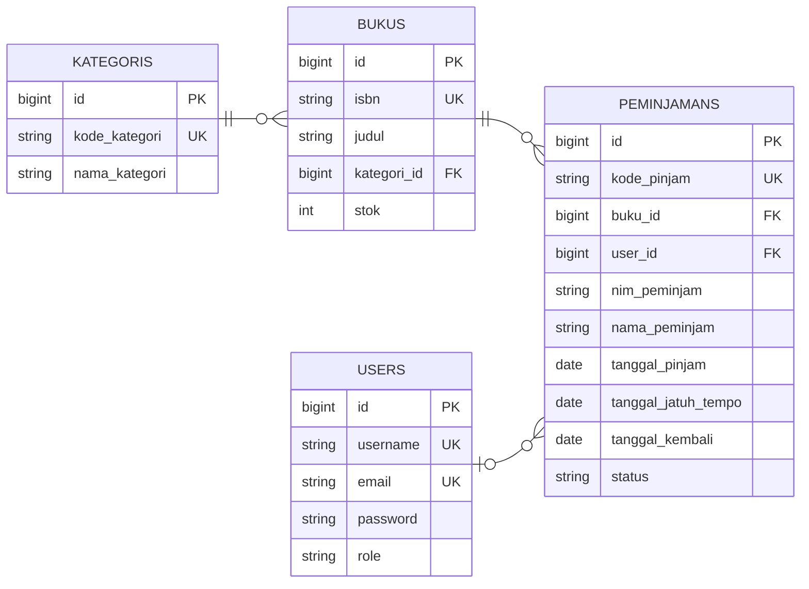

# SIPUS-Del — Sistem Informasi Perpustakaan Kampus Del (Minggu 5 + Minggu 6)

| | |
|---|---|
| **Nama Mahasiswa** | Fredrick Laurensius Aritonang |
| **NIM** | 12S24001 |
| **Prodi** | Sistem Informasi |
| **Mata Kuliah** | Pemrograman dan Pengujian Aplikasi Web |
| **Dosen** | Chandro Pardede, S.Kom., M.Sc |

Laravel 11, MySQL (InnoDB). Branch pengumpulan Minggu 6: `week6-db-session`.

## Instalasi

```bash
git clone https://github.com/FredrickAritonang/ppw-2026-week6-12S24001.git
cd ppw-2026-week6-12S24001
git checkout week6-db-session
composer install
copy .env.example .env
php artisan key:generate
php artisan migrate:fresh --seed
php artisan serve
```

Buat database kosong di MySQL dan sesuaikan `DB_*` di `.env` sebelum `migrate:fresh --seed`.
Berkas `.env` dan folder `vendor/` tidak di-commit.

## Akun uji

| Peran | Username | Password |
|---|---|---|
| Pustakawan | `pustakawan@del.ac.id` | `password123` |

Peminjaman dan pengembalian dicatat oleh Pustakawan melalui menu Sirkulasi.

## ERD



| Relasi | Kardinalitas | Keterangan |
|---|---|---|
| `KATEGORIS` ke `BUKUS` | satu ke banyak | Satu kategori memiliki banyak buku (`hasMany` dan `belongsTo`) |
| `BUKUS` ke `PEMINJAMANS` | satu ke banyak | Satu buku dapat dipinjam berkali-kali, FK `buku_id` dengan `cascadeOnDelete` |
| `USERS` ke `PEMINJAMANS` | satu ke banyak, opsional | Pustakawan yang mencatat peminjaman, FK `user_id` dengan `nullOnDelete` |

## Ringkasan implementasi

| Rubrik | Implementasi |
|---|---|
| Migrasi `peminjamans` | `create_peminjamans_table`: FK `buku_id` dengan `cascadeOnDelete`, `kode_pinjam` unik, kolom `status` (`dipinjam` atau `dikembalikan`) |
| Relasi Eloquent | `Peminjaman` (`$fillable`, `belongsTo(Buku::class)`) dan `Buku` (`hasMany(Peminjaman::class)`) |
| Transaksi ACID dan locking | `SirkulasiController`: `DB::transaction` dan `Buku::where('id', $id)->lockForUpdate()->firstOrFail()`; stok 0 ditolak; NIM sama dengan buku sama yang belum dikembalikan ditolak; stok dikurangi dengan `decrement` dan dikembalikan dengan `increment`; `QueryException` dicatat dengan `Log::error` |
| Query Builder | `KatalogController`: `DB::table()` untuk empat statistik, `Buku::with('kategori')->withCount('peminjamans')`, filter `when()` (judul, penulis, ISBN, kategori), `paginate()->withQueryString()` |
| Sesi dan Cookie | `AuthController`: `Auth::attempt`, `session()->regenerate()` saat login, `invalidate()` dan `regenerateToken()` saat logout; session state (`pencarian_terakhir`, `peminjam_terakhir`, `login_timestamp`); `Cookie::queue` (`del_last_user`, `del_peminjam_terakhir`) |
| Proteksi rute | Semua rute mutasi (CRUD buku dan kategori, peminjaman, pengembalian) berada di grup middleware `auth` |
| Seeder | `PustakawanUjiSeeder`, `BukuUjiSeeder` (stok 0 dan stok 1), `TransaksiSeeder` (sampel peminjaman) |
| Tampilan | Pilihan tema warna (biru, merah, hijau, ungu) di sidebar, disimpan di `localStorage` browser; warna solid tanpa gradasi; font Bricolage Grotesque dan Figtree |

## Bukti pengujian

### 1. Peminjaman berhasil
Pustakawan mencatat peminjaman ISBN `9780000000002` (stok 1). Kode peminjaman dibuat dan stok berkurang menjadi 0.


### 2. Pengembalian berhasil, stok bertambah
Pengembalian mengubah status menjadi `dikembalikan`, mengisi `tanggal_kembali`, dan menambah stok kembali.


### 3. Penolakan stok = 0 (rollback)
Peminjaman ISBN `9780000000001` (stok 0) ditolak dan transaksi dibatalkan.


### 4. Stok = 1: peminjam pertama berhasil, peminjam kedua ditolak
Setelah peminjam pertama mengambil buku terakhir, peminjam kedua ditolak karena stok habis.


### 5. Audit Cookie HttpOnly (DevTools, Application, Cookies)
`laravel_session`, `del_last_user`, dan `del_peminjam_terakhir` memiliki HttpOnly dan SameSite `Lax`.
`XSRF-TOKEN` tidak HttpOnly karena memang harus dapat dibaca JavaScript.


### 6. Log error transaksi
`storage/logs/laravel.log` mencatat `[DB EXCEPTION]` bila `QueryException` terjadi pada peminjaman atau pengembalian.

## Riwayat commit

```
feat(migration): create peminjamans table with foreign key to bukus
feat(transaction): implement ACID book borrowing and return with lockForUpdate
feat(query-builder): add library analytics dashboard and dynamic search
feat(auth-session): implement librarian login, session regeneration, and cookies
feat(seeder): add librarian account, zero and one stock books, and sample loans
style(ui): remove gradients and switch to custom fonts
docs(readme): add ERD, test accounts, and ACID test evidence
docs(readme): finalize README and fix screenshot filenames
docs(readme): simplify test account and redraw ERD
docs(readme): update clone URL to week6 repository
docs(readme): clear ERD relation labels and add relation table
style(ui): replace purple theme with teal palette
docs(readme): update screenshots with new theme
feat(ui): add user selectable color themes and stop prefilling login username
docs(readme): update commit history and add theme feature
```